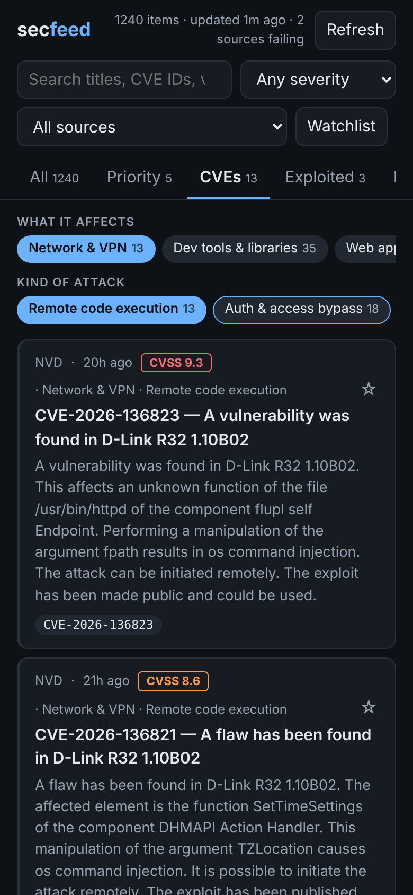
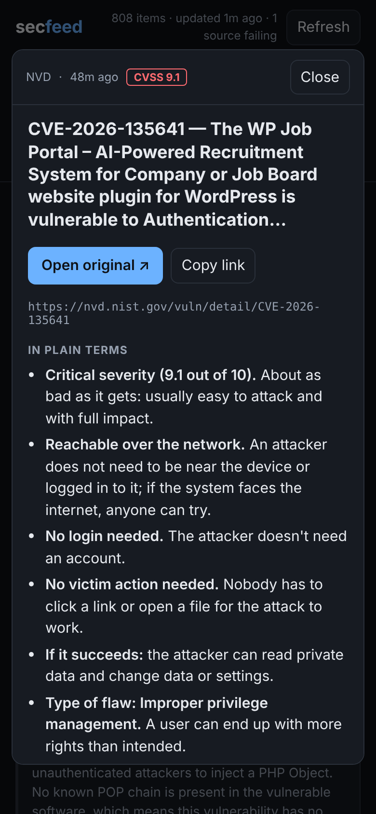

# secfeed

A personal security news reader. It pulls CVEs, known-exploited alerts,
security news and AI-security research (prompt injection, jailbreaks, agent
attacks) into one local feed.

It is self-contained in this directory and unrelated to qtop. It uses only the
Python standard library (3.9+), so there is nothing to install.



## Run it

```sh
cd secfeed
python3 secfeed.py serve          # then open http://127.0.0.1:8787
```

`serve` fetches every source at start, again every 30 minutes, and serves the
reader. It binds to `127.0.0.1`, so only this machine can reach it. To read it
from your phone on the same network, pass `--host 0.0.0.0` (anyone on that
network can then open it; there is no login).

Other commands:

```sh
python3 secfeed.py fetch          # fetch once and exit (for cron)
python3 secfeed.py build site/    # write index.html + data.json for static hosting
python3 -m unittest discover -s tests
```

## What it reads

| Tab | Sources | Needs |
| --- | --- | --- |
| CVEs | NVD (CVSS 7.0+ by default), CISA Known Exploited Vulnerabilities, GitHub Advisories, new GitHub repos named after a CVE (PoCs) | nothing |
| News | The Hacker News, BleepingComputer, Krebs, SANS ISC, Schneier, SecurityWeek, The Record, Dark Reading | nothing |
| AI security | Simon Willison's prompt-injection posts, Embrace The Red, arXiv (prompt injection, LLM jailbreak), Hacker News, new GitHub repos | nothing |
| Social | X recent search, Threads keyword search | API tokens, see below |

Tap any item to open its detail view: the link, a plain-language explanation
(how it can be attacked, what an attacker gains, what to do), the full
description, affected products, references and related items in your feed.
The explanation is built from facts the sources publish (the CVSS vector,
weakness type and CISA status), so it needs no AI service or API key.



The reader also cross-links: any item that mentions a CVE gets a clickable
chip, a news story about a CVE that is in CISA KEV is flagged "known
exploited", and anything about AI tooling from any source also appears under
"AI security". The Watchlist button stores keywords (vendors, products) in
your browser and gives matches their own tab.

## Optional tokens

Set these as environment variables before running. None are stored on disk.

| Variable | Effect |
| --- | --- |
| `GITHUB_TOKEN` | Raises GitHub's rate limit (unauthenticated search allows 10 requests a minute, which is enough for the defaults). |
| `NVD_API_KEY` | Raises NVD's rate limit. Free from nvd.nist.gov. |
| `X_BEARER_TOKEN` | Enables the X source. X's API is paid; without the token the source is skipped. |
| `THREADS_ACCESS_TOKEN` | Enables the Threads sources. Needs a Meta developer app with the `threads_keyword_search` permission. |

There is no free, sanctioned way to read X or Threads, and scraping them
breaks their terms and breaks often, so those two sources stay off until you
supply a token. The X and Threads fetchers are tested against the documented
response shapes only; they have not been run against the live APIs.

## Changing sources

Edit `sources.json`. Each entry has a `type` (`rss`, `nvd`, `kev`, `ghsa`,
`github_search`, `hn`, `x`, `threads`), a `name`, and a `category` (`cve`,
`news`, `ai`, `social`). Adding a blog is one line:

```json
{"type": "rss", "name": "Some Blog", "category": "news", "url": "https://example.com/feed.xml"}
```

Set `"enabled": false` to switch a source off. For NVD, `min_severity` sets
the CVSS floor (NVD publishes several hundred CVEs a day; CVEs about AI tooling
are kept whatever their score). The Sources panel at the bottom of the reader
shows each source's last result, including why one failed.

## Safety notes

Feeds are untrusted input. Summaries are reduced to plain text on the way in,
only `http(s)` links are kept, the page inserts everything as text rather than
HTML, and the server sends a Content-Security-Policy that allows no
third-party resources.
